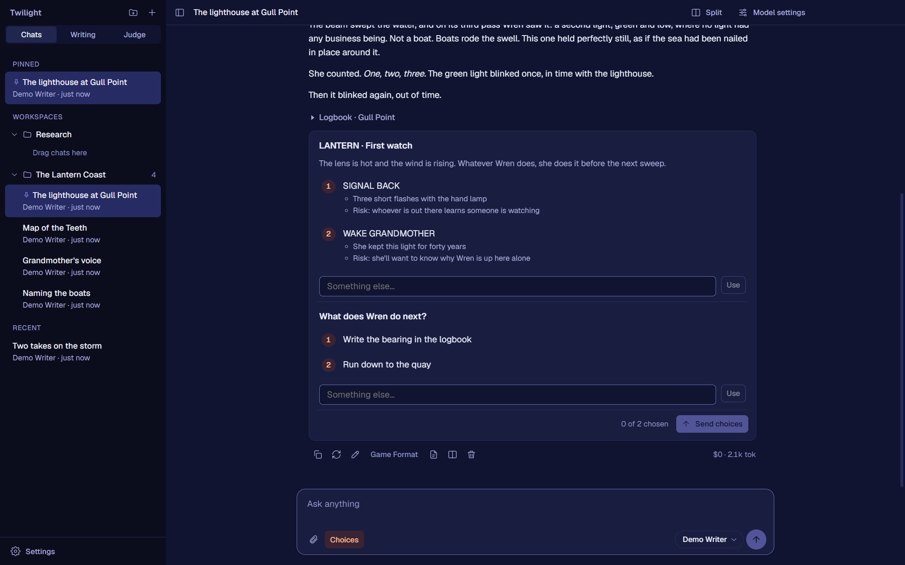
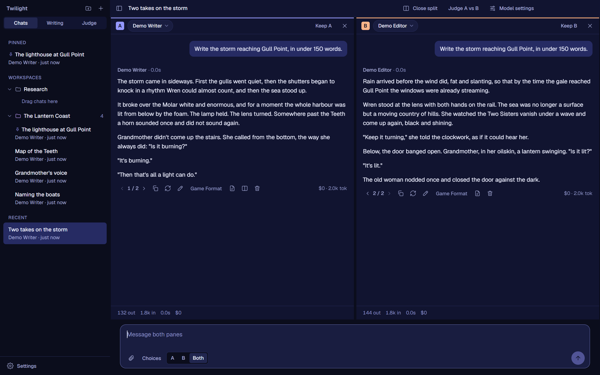
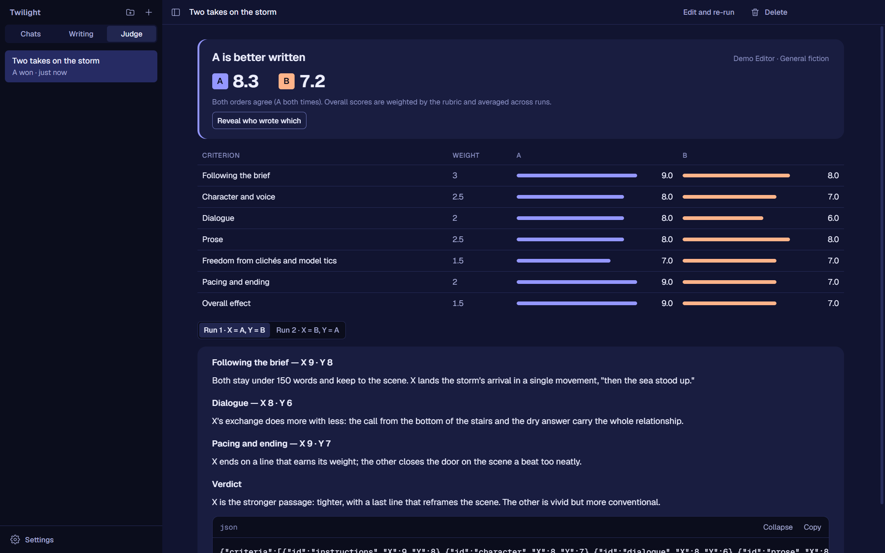
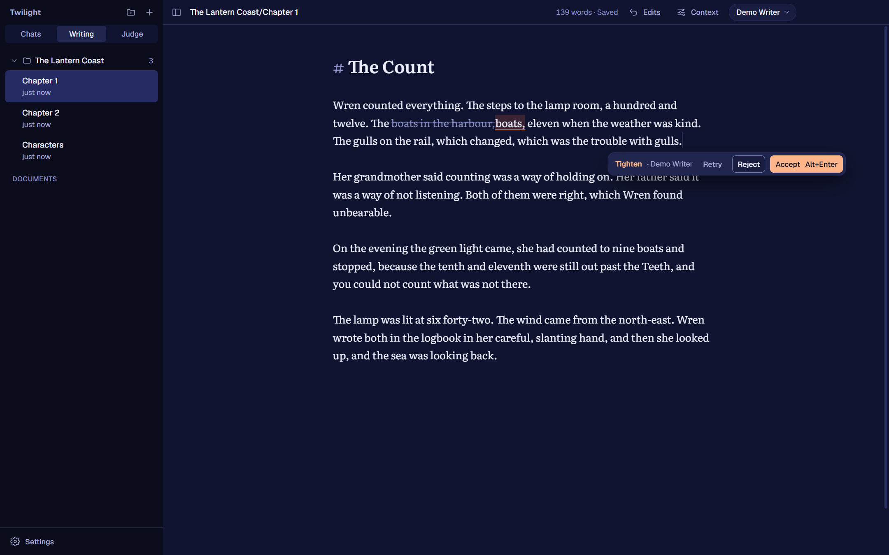
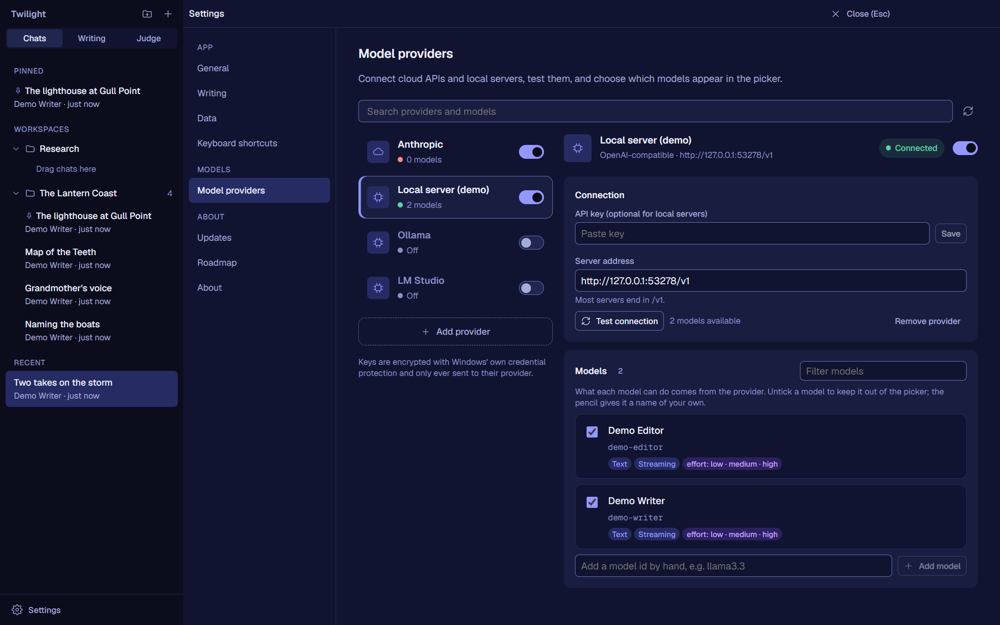
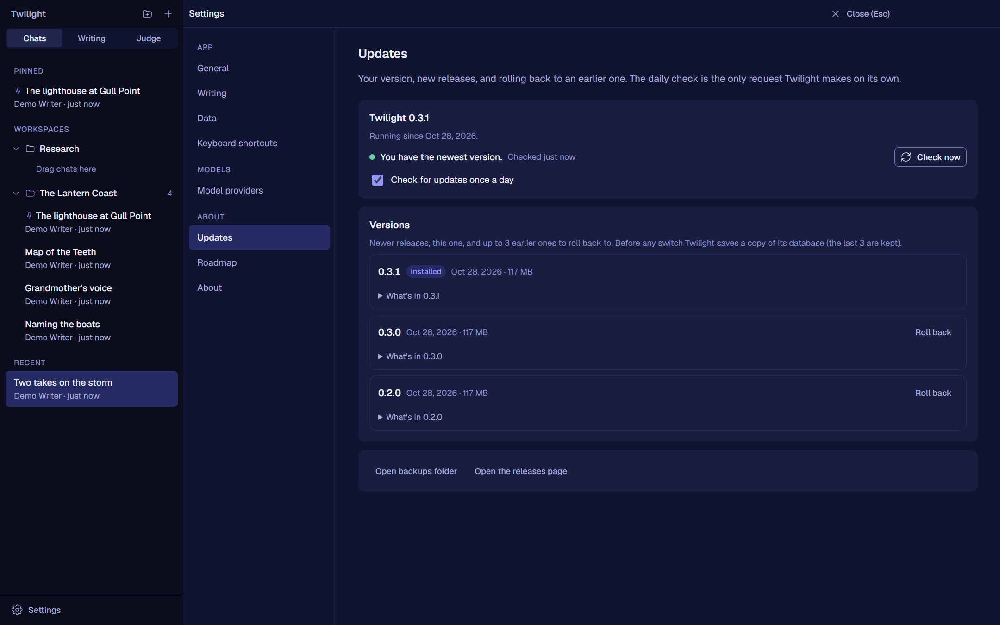
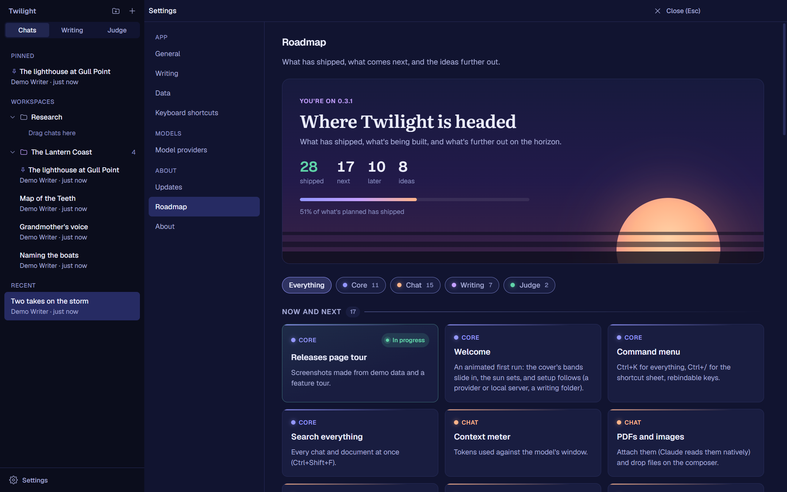

<div align="center">

# Twilight

**A fast, local-first desktop app for writing with language models.**
Claude and any OpenAI-compatible model (OpenRouter, LM Studio, Ollama, llama.cpp) in one dark, quiet workspace for long-form fiction and text adventures.

[**Download the latest release**](https://github.com/invictus-1/twilight/releases/latest) · Windows 10 and 11, 64-bit



</div>

## Before you download: this is a personal project

Twilight is a personal project. I built it for my own very specific use, and I release it as-is in case it's useful to someone else. My use is long-form fiction and text adventures: chats that run to 300k+ tokens, side-by-side model comparisons, a writing editor for manuscripts of 100k+ words, and a judge that scores two passages against my own rubric.

It does those things the way I want them done, so please set your expectations to match:

- Features, defaults and priorities follow my workflow. It isn't trying to be a general-purpose assistant app, and it may never have what your workflow needs.
- Feature requests and support aren't offered. Issues are turned off.
- The source is here for anyone curious, but it's shaped around my needs first.
- It's Windows only and not code-signed (see [Download](#download)).
- Things can change or break between versions. Settings → Updates can roll back to an earlier version, and Twilight backs up its database before every update.

If that still sounds like what you're after, welcome. Enjoy it.

*Every screenshot here is made from demo data: an invented story and a stand-in model.*

## What it does

### Chat that keeps up with long stories

- **Conversations are trees.** Regenerate or edit any message and the earlier version stays; ‹ 2 / 3 › switches between them.
- **Message actions:** copy, regenerate, edit, delete one message or everything below it, undo, and a Recently deleted panel to read or restore. Every reply shows its tokens, cost and speed.
- **Built for very long chats.** Requests are built so the prompt cache keeps working turn after turn, and scrolling stays smooth on a 350k-token chat.
- **Full markdown and safe HTML:** tables, footnotes, code blocks, and collapsible `<details>` blocks for things like a logbook or status card. Scripts and event handlers are stripped.
- **Workspaces** with their own system prompt, model and color; pinned chats; files attached in full.

### Choice cards for text adventures

When the story reaches a decision, the options become a card you can click, edit before sending, or answer in your own words. A reply can hold several decisions at once (an outfit and then an action, say, or one choice per character), and nothing is sent until each has a pick.

There are three ways for a model to offer choices, each with its own switch:
- a **tool call**, where the model sends the options as data;
- a **choices block** in the reply;
- **plain numbered options**, written the way your own system prompt asks for them.

A plain list only becomes a card when it reads as a decision: under a title that asks, or with a "Something else" option. Other lists stay lists.

### Split compare



Clone a chat into two panes and send to A, B or both. Each pane has its own model, settings and system prompt. Keep the branch you like.

### The Judge



Two passages are scored blind by a judge model you choose, against a rubric, criterion by criterion. Each pair is judged twice with the order swapped, because judges tend to favour whichever passage comes first. A general fiction rubric is included; write your own, or import and export rubrics as files. You can send both replies from split compare straight to the Judge.

### A writing editor



Markdown documents in any folder you choose (an Obsidian vault works as is). A 100k-word manuscript opens in a blink. Select a passage and **Ask**, **Rewrite**, **Tighten**, **Expand** or change its **Tone**. The suggestion appears as an in-place diff to accept or reject, and every accepted edit can be reverted. Each document can carry its own instructions and reference documents, or send the whole manuscript, which is cached.

### Writer insights

Your writing folder, seen as numbers: words written today, this week and this year; a heatmap of the days you write; streaks and your best day; sentence length, dialogue share, adverb density and vocabulary; which characters get the most page time and who shares scenes with whom. The first scan of a folder is a baseline, so a finished manuscript isn't counted as one day's writing. Achievements unlock quietly along the way.

### Your models, your keys



- **Claude** through your own Anthropic API key, with adaptive thinking and each model's own effort levels.
- **Any OpenAI-compatible server:** OpenRouter, OpenAI, LM Studio, Ollama, llama.cpp, vLLM.
- What each model can do is read from its provider. You can hide models, rename them, or add them by hand.
- Keys are encrypted with Windows' own credential protection and only ever sent to their provider.

### Updates you control



Twilight checks this repository's releases once a day (you can turn that off) and updates in one click. Any of the last three versions is a click away if an update doesn't suit you. Your database is backed up before every switch.

### A roadmap inside the app



Settings → Roadmap shows what has shipped, what's next and what's further out.

## Private by design

- The interface never touches the network. Fonts are bundled, and web requests from the window are blocked.
- Your chats, documents and settings stay on your computer.
- Model requests go only to the providers you set up.
- The once-a-day update check (which you can turn off) is the only request Twilight makes on its own.

## Download

Get `Twilight-Setup-<version>.exe` from the [latest release](https://github.com/invictus-1/twilight/releases/latest), or the portable `.zip`.

The installers aren't code-signed, so Windows SmartScreen may warn the first time you run one. Choose **More info**, then **Run anyway**.

For Claude you need an API key from [console.anthropic.com](https://console.anthropic.com) (a Claude subscription can't be used). Local models need a server such as LM Studio or Ollama running on your computer.

## For developers

Electron + React + TypeScript. [CLAUDE.md](CLAUDE.md) has the ground rules and a map of the code, [design/](design/) the design system, [ROADMAP.md](ROADMAP.md) what's next and [CHANGELOG.md](CHANGELOG.md) what changed.

### Run

```bash
npm install
npm run dev        # hot-reloading dev build
npm run build      # production bundles in out/
npm start          # run the production build
npm run dist       # Windows installer (.exe) and portable .zip in release/
npm run typecheck
```

Add an Anthropic API key, or start Ollama / LM Studio, under **Settings → Providers**. What's done and what's next: [ROADMAP.md](ROADMAP.md).

`npm run dist` writes `release/Twilight-Setup-<version>.exe` (installer) and `release/Twilight-<version>-x64.zip` (portable). The builds are unsigned, so Windows SmartScreen asks once ("More info" → "Run anyway"). `npx electron scripts/make-icon.cjs` regenerates the app icon and `npx electron scripts/make-installer-art.cjs` the installer artwork.

#### Model settings and workspaces

Each chat (and each split pane) has its own model settings: an editable system prompt (sent with every message; a change restarts the prompt cache), recent message limit, temperature where the model accepts it, max output tokens, thinking effort, thinking display, caching on/off with its lifetime, and extra request JSON merged in last. Effort levels are read per model from the Anthropic Models API, in Anthropic's own names; OpenAI-compatible servers get the standard `reasoning_effort` names (OpenRouter's `reasoning.effort`). Settings can be saved as presets. A status line under the chat says whether the last reply hit the prompt cache.

Workspaces group chats and carry defaults: new chats in a workspace start with its system prompt (optionally headed by its name and description) and model. Attach text files to a message with the paperclip; their full text goes into that message.

### How it's built

- `src/main` — the Electron main process. Owns the SQLite database (`db.ts`), API keys (`secrets.ts`, encrypted with Windows DPAPI via `safeStorage`), providers (`providers/`) and the chat engine (`chat.ts`). All network traffic to models happens here.
- `src/preload` — the typed bridge (`window.twilight`) between the interface and the main process.
- `src/renderer` — the React interface. It never touches the network: every web request from it is blocked.
- `src/shared` — types and pricing shared by both sides.
- `design/tokens.json` — tokens copied from the design system; `node scripts/tokens.mjs` regenerates `src/renderer/src/styles/tokens.css`.

#### Conversations are trees

Each chat is a tree of messages under a hidden root. Regenerating adds a sibling instead of overwriting, and the thread is the path of "active" children. That keeps every request append-only.

#### Split compare

Pane B is a second branch of the same tree: "Clone into split" (Ctrl+Shift+S, or the split icon on a reply) copies the conversation at that point, history, system prompt and settings included. Change B's model, then send to A, B or Both (Alt+1/2/3). B's branches never move pane A; "Keep A" or "Keep B" closes the split and continues on that branch, with the other still reachable from the version switcher. When both panes use the same model, B waits for A's first token so it reads A's prompt cache.

#### Folders

Chats sit in Twilight's own folders (a database record, nothing on disk), with Pinned and Recent sections; drag a chat onto a folder to file it, onto Recent to unfile it. Deleting a folder never deletes its chats. In Writing, folders are the real subfolders of the writing folder, so they match an Obsidian vault; dragging a document onto a folder moves the file, and a move never overwrites an existing file.

#### Writing

Documents are plain `.md` files in a folder you choose (it defaults to `Documents\Twilight`; an Obsidian vault works as is, and both apps can edit the same files). The editor is CodeMirror 6, the engine Obsidian uses; it loads on first use, opens a 115k-word manuscript in about 35ms, autosaves atomically, and picks up edits made outside Twilight when the window regains focus.

Select text for the writing tools: Ask (Ctrl+J), Rewrite, Tighten, Expand and Tone, plus formatting (bold Ctrl+B, italic Ctrl+I, strikethrough, code, heading, quote) and undo/redo. A tool's result streams in as a suggestion: a word diff shown in place, which changes nothing until you accept it (Alt+Enter) or reject it (Alt+Backspace or Esc). Only the selected passage ever changes. Accepted edits stay faintly marked and go into **Edits**, where each can be reverted on its own; a pill offers Revert right after accepting. "Send to Writing" on a chat reply turns it into a document.

**Context** (per document) is what the tools send along, like a chat: standing instructions, reference documents sent in full (a character bible, an outline), and optionally the whole manuscript instead of about 1,000 words around the selection. Instructions and references go in the cached system prompt; the manuscript has its own cache breakpoint; the passage and instruction come last. Context is stored in Twilight's database, never in your files, and follows a document when it moves. The tools use the default model at low effort.

#### Safety net

Deleting a chat moves it to the Trash at the bottom of the sidebar; Restore brings it back, and only "Delete forever" or "Empty trash" removes it. Request logs (on by default, Settings → Safety net) append every chat turn and writing-tool run, prompt and reply, to a daily JSON Lines file in the app's `logs` folder. API keys are never written to them.

#### Prompt caching

Caching is a prefix match, so requests are built to be the previous request plus new turns:

- The system prompt is frozen when the chat starts and carries its own cache breakpoint.
- Claude's replies are stored as the exact content blocks the API returned (thinking blocks included) and replayed unchanged.
- A top-level `cache_control` moves the second breakpoint to the end of the conversation.
- Cache lifetime defaults to 1 hour (Chat settings), for writers who pause between messages.
- Nothing volatile (dates, IDs) is ever added to the prefix. Switching models, or changing effort mid-chat, re-caches once; the interface says so.

Every reply shows its cost, token count and how much of the prompt was read from cache.

#### Scrolling performance

Messages render with `content-visibility: auto` and an estimated height so huge chats open fast, inside a plain block container (not flex: a flex column re-lays out every sibling when one message changes size). Once the chat has painted, everything is laid out in one idle pass, so scrolling afterwards does no layout at all.

#### Tests

After `npm run build`, both run in a throwaway profile and never touch your real data:

- `TWILIGHT_SELFTEST=<folder> npx electron .` seeds a ~350k-token chat, scrolls it top to bottom one step per frame, and writes `selftest.json` (frame timings) and `selftest.png`.
- `TWILIGHT_E2E=<folder> npx electron .` starts a fake OpenAI-compatible model server in-process and drives the real app through every feature (chat, split compare, choices, the Judge, writing tools, insights, updates), writing `e2e.json` (200+ checks) and screenshots.
- `TWILIGHT_SHOWCASE=<folder> npx electron .` fills a throwaway profile with an invented story and captures the screenshots in `docs/screenshots/`.
