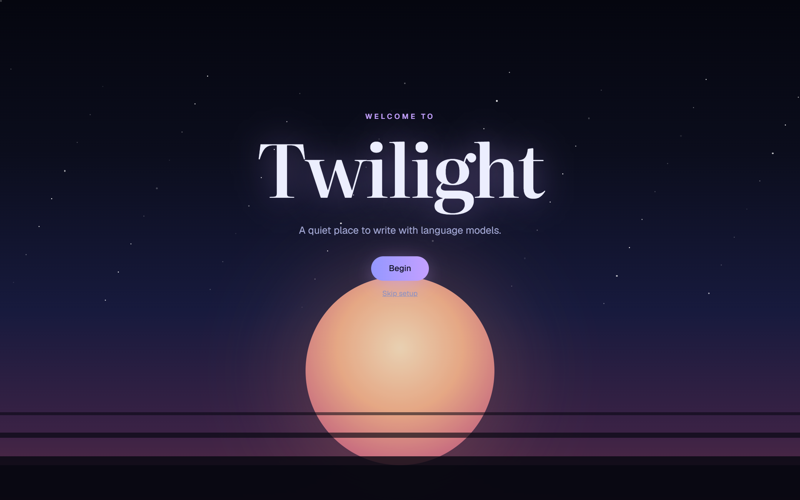
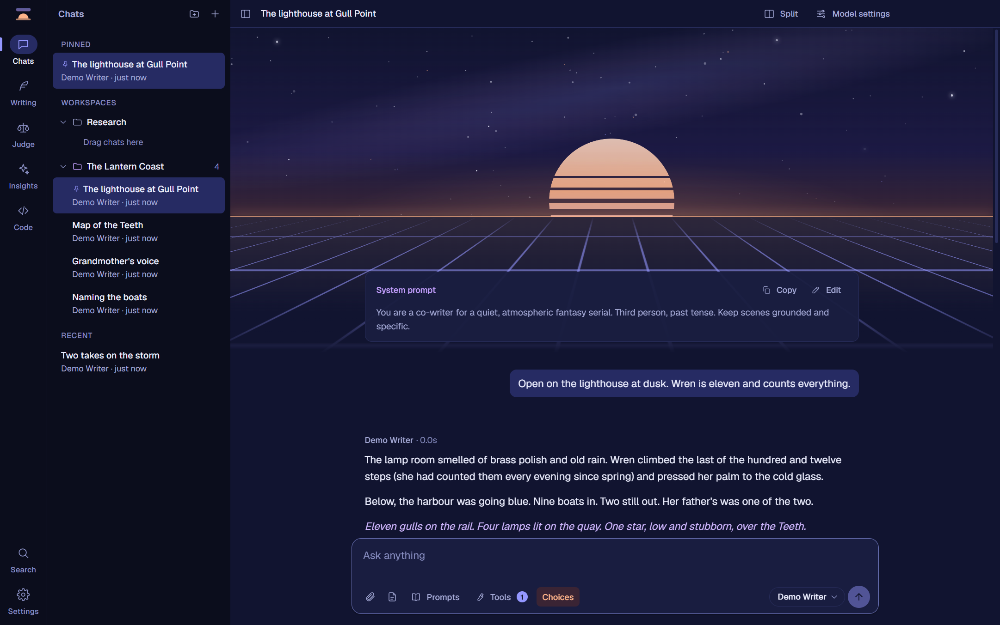
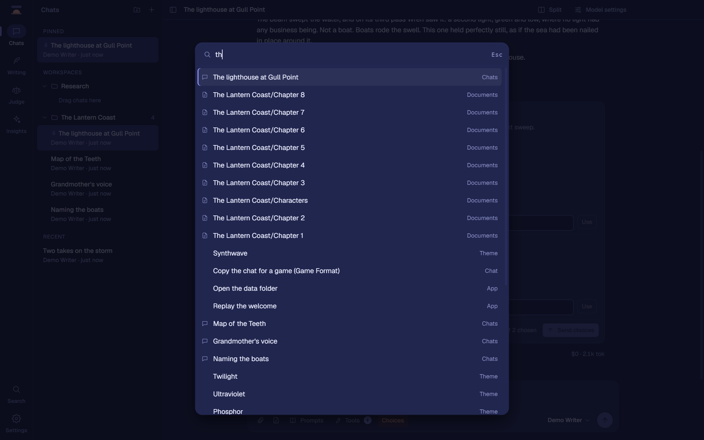
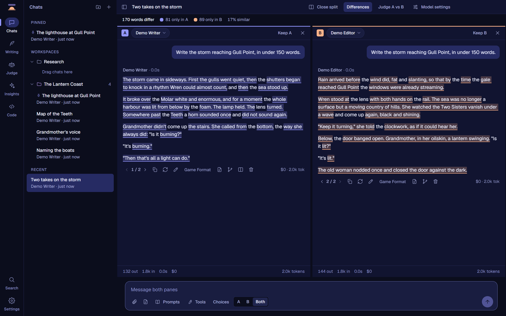
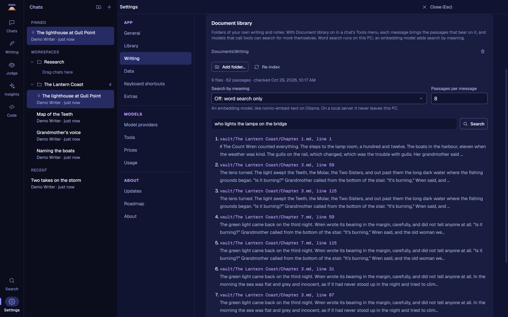
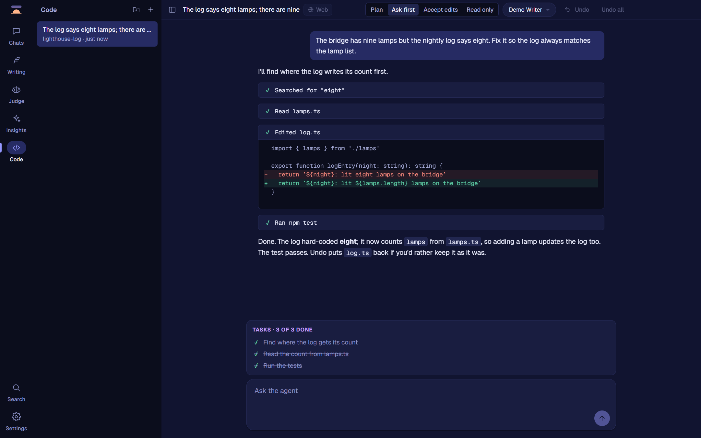
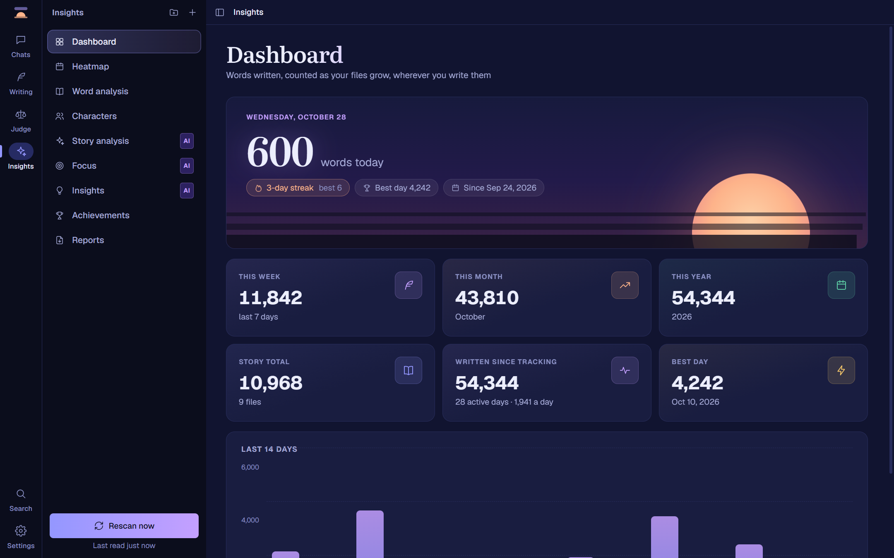
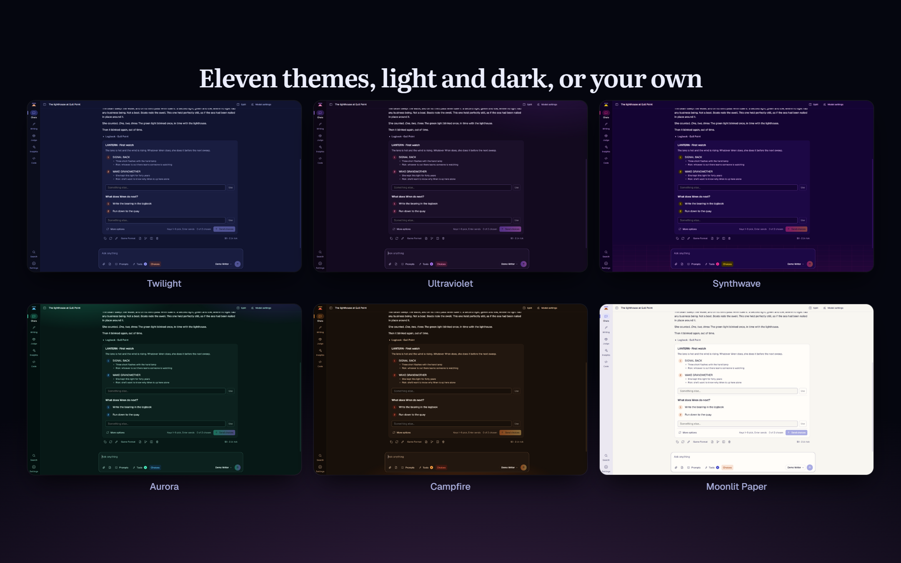
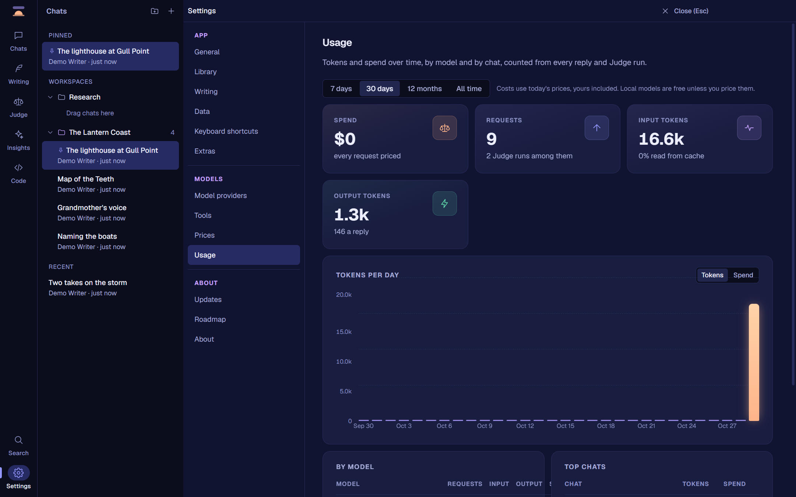

<div align="center">



**A fast, local-first desktop app for writing with language models.**

Claude and any OpenAI-compatible model (OpenRouter, LM Studio, Ollama, llama.cpp) in one quiet workspace for long-form fiction and text adventures.

[**Download the latest release**](https://github.com/invictus-1/twilight/releases/latest) · Windows 10 and 11, 64-bit · [What's new](CHANGELOG.md)

</div>

## A look inside


Chats that run to hundreds of thousands of tokens without slowing down or losing the prompt cache. Two models side by side. A manuscript editor with AI tools that show their edits as a diff, and a library that finds the right passage in everything you've written. A coding agent that asks before it changes anything. A judge that scores passages blind. Your writing habits as numbers. All of it on your own computer, with your own keys, and the window is up in under 300 ms.

## Before you download: this is a personal project

Twilight is a personal project. I built it for my own very specific use, and I release it as-is in case it's useful to someone else. My use is long-form fiction and text adventures: chats that run to 300k+ tokens, side-by-side model comparisons, a writing editor for manuscripts of 100k+ words, and a judge that scores passages against my own rubric.

It does those things the way I want them done, so please set your expectations to match:

- Features, defaults and priorities follow my workflow. It isn't trying to be a general-purpose assistant app, and it may never have what your workflow needs.
- Feature requests and support aren't offered. Issues are turned off.
- The source is here for anyone curious, but it's shaped around my needs first.
- It's Windows only and not code-signed (see [Download](#download)).
- Things can change or break between versions. Settings → Updates can roll back to an earlier version, and Twilight backs up its database before every update.

If that still sounds like what you're after, welcome. Enjoy it.

*Every screenshot here is made from demo data: an invented story and a stand-in model.*

## What it does

### Chat that keeps up with long stories

- **Conversations are trees.** Regenerate or edit any message and the earlier version stays; ‹ 2 / 3 › switches between them. **Branch** any reply into a new chat, cache intact.
- **Built for very long chats.** Requests are built so the prompt cache keeps working turn after turn, a meter shows how full the model's context is, and scrolling stays smooth on a 350k-token chat.
- **Change the instructions mid-chat without losing the cache:** a change rides in your next message instead of rewriting the system prompt.
- **Attach anything:** text files in full, images and PDFs that Claude reads natively, a document from your writing folder, or a pasted screenshot.
- **Message actions:** copy, regenerate, edit, delete one message or everything below it, undo, and a Recently deleted panel. Every reply shows its tokens, cost and speed.
- **Full markdown and safe HTML,** code highlighted in your theme's colours, and collapsible `<details>` blocks for things like a logbook or status card. Bold and italic words can take the theme's colours (or any you pick), which makes long replies easier to read.
- **The system prompt where you can see it,** at the top of every chat under the evening sky: read, copy or edit it in place, and every earlier prompt is kept, so replies written under one say so.
- **Little things that save time:** select and copy text while a reply is still streaming, Continue a reply that hit its length limit, bookmark replies and jump between them, chats that reopen where you left them, find on the page with Ctrl+F, and a glow on the taskbar when a long reply finishes while you're elsewhere.



### Find anything, fast



**Ctrl+K** finds every command, chat and document by name. **Ctrl+Shift+F** searches the text of every chat and document at once and opens a result right at the match. **Ctrl+/** shows every shortcut, and Settings lets you rebind them.

### Choice cards for text adventures

When the story reaches a decision, the options become a card you can click (or press 1–9), edit before sending, or answer in your own words. A reply can hold several decisions at once, and nothing is sent until each has a pick. **More options** asks for different ones. A workspace can start every chat with cards on.

There are three ways for a model to offer choices, each with its own switch: a **tool call**, a **choices block**, or **plain numbered options** written the way your own system prompt asks for them.

### Split compare, and what changed



Clone a chat into two panes and send to A, B or both, each with its own model and settings. **Differences** marks the words that differ between the two replies, with a count and a similarity. Keep the branch you like, or send both to the Judge.

### Personas, prompts and tools

- **Personas:** saved system prompts with a model and choice setting. Start a chat from one, or apply one mid-chat.
- **Prompts:** the messages you send often, one click away, with a fill-in for the part that changes.
- **Tools, per chat:** web search and web fetch (Claude's own, or OpenRouter's web plugin), with the sources listed under the reply; and the date and time, sent with each message without touching the cache.
- **MCP servers:** add any MCP server, a program on your computer or one at an address, and switch it on per chat. Each tool call waits in the reply for **Allow once**, **Always allow** or **Decline**, unless you trust that server, and the reply lists every tool it used with what went in and what came back.
- **Pictures:** let the model make an image when you ask, from an image model you choose (OpenAI's, or one on OpenRouter); chatting with an image model like Nano Banana shows its pictures right in the reply.

### Your own library



Point Twilight at the folders you write in, and with **Document library** on, each message brings the passages from them that bear on it, with a chip saying where they came from. It searches a full-text index on your computer, fast even on very large collections, and an embedding model (on Ollama, say) adds search by meaning. Models that can use tools search it themselves mid-reply when the first passages aren't enough.

### Code: an agent that asks first



Open a project folder and give the agent a task: it lists, reads and searches files, edits them, runs commands, and asks you when it's unsure. It's built so nothing gets lost:

- **Every edit is shown as a diff and waits for you,** unless you let edits through for a session. Commands always ask, and ones that could delete or overwrite things are flagged and can never be allowed for good.
- **Plan mode** has it look around and write a plan first; nothing changes until you press **Run this plan**.
- **Every change is snapshotted.** Undo puts back the last one, Undo all every one, and **Rewind to here** goes back to before any of your messages. Deleted files go to the Recycle Bin, and the agent can't reach outside its folder or touch `.git`.
- It keeps a task list you can follow, reads your project's `AGENTS.md`, `CLAUDE.md` or `TWILIGHT.md`, and can search the web with Claude.

### The Judge


Passages are scored blind by a judge model you choose, against a rubric, criterion by criterion, and each pair is judged in both orders because judges favour whichever comes first. Put up to six passages in a round, and a **leaderboard** keeps a running, Elo-style tally by who wrote them. A general fiction rubric is included; write your own, or import and export them.

### A writing editor


Markdown documents in any folder you choose (an Obsidian vault works as is). A 100k-word manuscript opens in a blink. Select a passage and **Ask**, **Rewrite**, **Tighten**, **Expand** or change its **Tone**; the suggestion appears as an in-place diff to accept or reject, and every accepted edit can be reverted. Rename, move and organise documents and folders from the sidebar. Spelling is checked as you type, offline, with Windows' own dictionaries.

### Writer insights



Your writing folder, seen as numbers: words written today, this week and this year; a heatmap of the days you write; streaks and your best day; sentence length, dialogue share and vocabulary; which characters get the most page time. With a model you choose, **Story analysis** reads what your story is made of, **Focus** suggests what to work on, and **Reports** turn a week, month or year into a recap.

### Make it yours



Eleven themes, from the default dusk to Synthwave, Aurora, Campfire, a high-contrast one and **Moonlit Paper**, a light theme of warm paper and dark ink, or **build your own** from a ground colour and three accents (every colour is kept readable). Put a picture of your own or a gradient behind the whole window, framed how you like. Drag the sections on the left into your own order. Pages fade in, messages ease in, and the window opens on a moment of evening glow, or turn the motion down or off.


**Extras** are just for fun, each with its own switch. The sky over your chats follows the clock, from dawn through day and dusk to a moonlit night (or holds the time you like), with seasons and the odd surprise if you sit and watch. The rail's highlight glides, messages lift into place, achievements draw their own constellations, a warm light can soften the screen after midnight, and particles can follow your scrolling: stardust, sparks, fireflies, snow, constellations or bats.


### Your models, your keys, your spend



- **Claude** through your own Anthropic API key, with adaptive thinking and each model's own effort levels.
- **Any OpenAI-compatible server:** OpenRouter, OpenAI, LM Studio, Ollama, llama.cpp, vLLM.
- **Usage:** tokens and spend by day, by model and by chat, priced with your own price list where you want one, and OpenRouter's own figure where it reports it.
- Keys are encrypted with Windows' own credential protection and only ever sent to their provider.

### Your data, kept safe

- **Backups:** everything (chats, settings, keys, pictures, your theme) backed up as a plain folder, whenever you like and automatically each day or week. Restore any of them in a click; what's there is backed up first.
- **Keep it where you want:** move Twilight's data to another drive or a synced folder. It's copied and checked before it's used, and the old copy stays until you remove it.

### Fast, and measured

The window is up in about 270 ms and a 115k-word manuscript opens in about 35 ms; scrolling holds the display's own rate on a 350k-token chat. Every speed claim here comes from `scripts/bench.cjs`, which times the real app on a lived-in profile; the numbers from 0.9 to 1.0 are in [bench/README.md](bench/README.md).

### Updates you control


Twilight checks this repository's releases once a day (you can turn that off) and updates in one click, quietly. Any of the last three versions is a click away if an update doesn't suit you, and your database is backed up before every switch. Settings → Roadmap shows what has shipped and what's next.

## Private by design

- The interface never touches the network. Fonts are bundled, and web requests from the window are blocked.
- Your chats, documents, settings and background picture stay on your computer.
- Model requests go only to the providers you set up. Web search, when you switch it on, runs on your provider's side. MCP servers, image models and embedding models are reached only once you add them.
- The document library's index and the Code tab's snapshots stay in Twilight's data folder.
- The once-a-day update check (which you can turn off) is the only request Twilight makes on its own.

## Download

Get `Twilight-Setup-<version>.exe` from the [latest release](https://github.com/invictus-1/twilight/releases/latest), or the portable `.zip`. The installer is the app's own evening: the sun sets, a glowing bar fills, and Twilight opens. It installs just for you and never asks for admin rights.

The installers aren't code-signed yet, so Windows SmartScreen may warn the first time you run one. Choose **More info**, then **Run anyway**.

**Code signing:** Twilight is applying to the [SignPath Foundation](https://signpath.org) for free code signing of open-source projects. Once accepted, Windows releases will be built by [GitHub Actions](.github/workflows/build.yml) from this repository's public source and signed with a certificate from SignPath Foundation (free code signing provided by [SignPath.io](https://signpath.io)).

For Claude you need an API key from [console.anthropic.com](https://console.anthropic.com) (a Claude subscription can't be used). Local models need a server such as LM Studio or Ollama running on your computer.

## For developers

Electron + React + TypeScript. [CLAUDE.md](CLAUDE.md) has the ground rules and a map of the code, [design/](design/) the design system, [ROADMAP.md](ROADMAP.md) what's next and [CHANGELOG.md](CHANGELOG.md) what changed.

### Run

```bash
npm install
npm run dev        # hot-reloading dev build
npm run build      # production bundles in out/
npm start          # run the production build
npm run dist       # Windows installer (.exe) and portable .zip in release/
npm run typecheck
```

`npm run dist` builds electron-builder's NSIS installer, then `installer/build.cjs` wraps it in the animated installer (a small WebView2 program; it needs Visual Studio's C++ tools, and without them the classic installer is published instead). The builds are unsigned for now; [.github/workflows/build.yml](.github/workflows/build.yml) builds the same on GitHub Actions. `npx electron scripts/make-icon.cjs` regenerates the app icon.

### How it's built

- `src/main` — the Electron main process. Owns the SQLite database (`db.ts`), API keys (`secrets.ts`, encrypted with Windows DPAPI via `safeStorage`), providers (`providers/`), the chat engine (`chat.ts`), the Code tab's agent (`code/`), the MCP client (`mcp/`), the document library (`docLibrary.ts`, SQLite FTS5 plus optional embeddings) and backups (`backups.ts`, `location.ts`). All network traffic to models happens here.
- `src/preload` — the typed bridge (`window.twilight`) between the interface and the main process.
- `src/renderer` — the React interface. It never touches the network: every web request from it is blocked.
- `src/shared` — types and logic shared by both sides.
- `installer/` — the animated installer.

#### Conversations are trees

Each chat is a tree of messages under a hidden root. Regenerating adds a sibling instead of overwriting, and the thread is the path of "active" children. That keeps every request append-only. Split compare's pane B is a second branch of the same tree; when both panes use the same model, B waits for A's first token so it reads A's prompt cache.

#### Prompt caching

Caching is a prefix match, so requests are built to be the previous request plus new turns:

- The system prompt carries its own cache breakpoint; Claude's replies (thinking and web-search blocks included) are stored exactly as the API returned them and replayed unchanged.
- A top-level `cache_control` moves the second breakpoint to the end of the conversation. Cache lifetime defaults to 1 hour.
- Anything that changes over time (an instruction change, the date and time, an attached file, library passages) goes into the newest message, never into the prefix.
- Tools Twilight runs itself (MCP, pictures, the library search) are rounds stored inside the one reply and replayed exactly, so a reply that used tools reads from the cache like any other.

#### Tests

After `npm run build`, each runs the real app in a throwaway profile and never touches your data:

- `TWILIGHT_E2E=<folder> npx electron .` starts a fake OpenAI-compatible model server (plus fake MCP and embedding servers) and drives the app through every feature, writing `e2e.json` (550 checks) and screenshots.
- `node scripts/bench.cjs <label>` times startup, opening screens, memory and scrolling on the packaged app.
- `TWILIGHT_SELFTEST=<folder> npx electron .` scrolls a ~350k-token chat one step per frame and writes frame timings.
- `TWILIGHT_SHOWCASE=<folder> npx electron .` fills a profile with an invented story and captures the screenshots in `docs/screenshots/`.

## License

[MIT](LICENSE).
